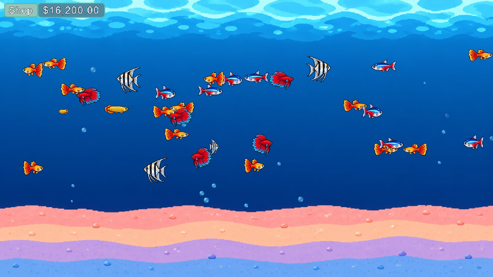
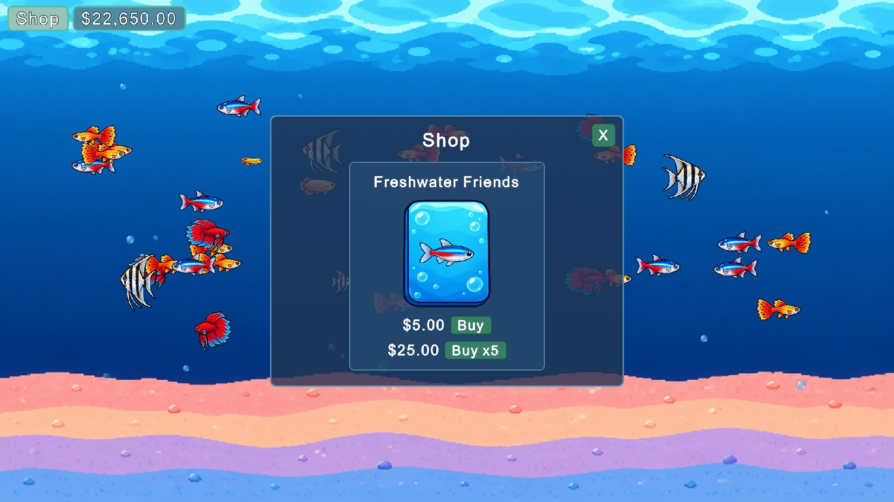
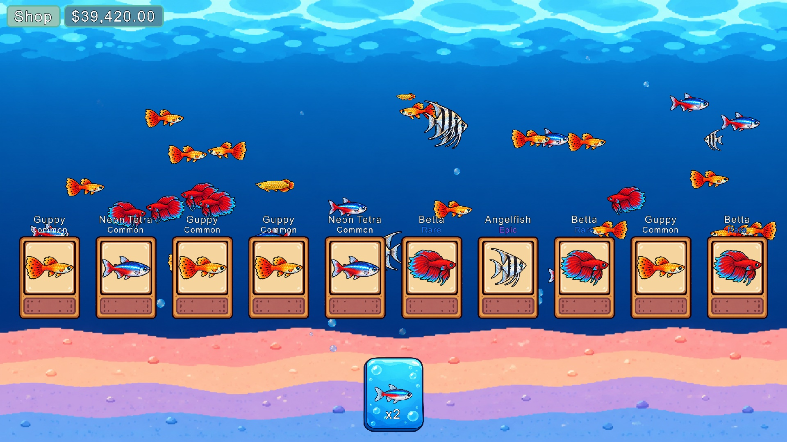
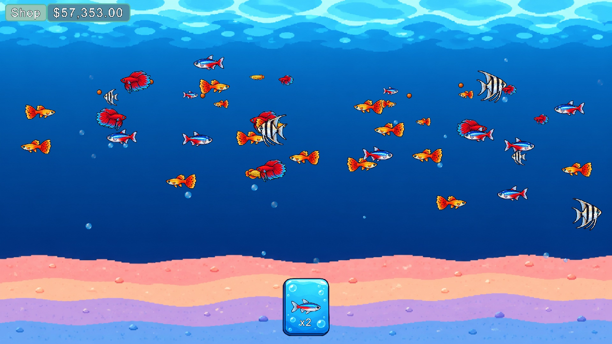

# Chillquarium Demo

A small, cozy idle aquarium game made in Unity as a learning project. Buy fish cards, collect fish of different rarities, feed the babies so they grow, and watch your tank earn money while you relax.

> This is an unofficial, non-commercial fan demo made to learn game development. It is inspired by [Chillquarium](https://store.steampowered.com/app/2276930/Chillquarium/) by Snapbreak and is not affiliated with or endorsed by them. All art and sounds in the game were made for this project; it uses no assets from the original game.

## Features

- **Fish cards:** the shop sells one card, "Freshwater Friends", one at a time or 5 at once. Bought cards wait at the bottom of the tank. Each click on them opens one and lays out 5 more random fish cards, which pop in while the cards already out squeeze aside. Click a card, or hold and swipe across the row, to send their fish into the tank; while you hold, the row keeps sliding toward the pointer and its cards are collected one after another. No food drops while fish cards are out.
- **Rarities:** every fish is Common, Rare, Epic or Legendary. Rarer fish drop less often and earn more.
- **Idle income:** every fish in the tank earns money each second. Babies earn a little, adults earn a lot.
- **Growing up:** fish earn XP over time. Babies stay small until their XP adds up, then grow into full-size adults with a new look.
- **Feeding:** click in the water to drop food, or hold the button to keep dropping it. Hungry babies chase the nearest pellet, and every bite gives them extra XP.
- **Stroke swimming:** fish swim like real fish. They push off in a stroke, squeeze and stretch, glide, slow down and stroke again in a new direction.
- **Saving:** money and fish are saved automatically, so the tank is waiting for you when you come back.
- **Polish:** rising bubbles, a bouncing money counter with floating "+$" labels, fish cards that pop in and spin away, and small sound effects.

| Shop | Card reveal | Feeding |
|---|---|---|
|  |  |  |

## Fish

| Fish | Rarity | Baby income | Adult income | XP to grow |
|---|---|---|---|---|
| Guppy | Common | $1/s | $4/s | 30 XP |
| Neon Tetra | Common | $1.5/s | $6/s | 45 XP |
| Betta | Rare | $5/s | $20/s | 90 XP |
| Angelfish | Epic | $15/s | $60/s | 180 XP |
| Golden Arowana | Legendary | $50/s | $200/s | 300 XP |

Babies earn 1 XP per second and 5 XP per food pellet. A card costs $5 and holds 5 fish. Drop chances by rarity: Common 70%, Rare 22%, Epic 7%, Legendary 1%. When a rarity has several fish, its chance is shared between them. Every value lives in one config asset (`Assets/Data/GameplayConfig.asset`), so the game can be tuned without touching code.

## How to play

1. Open the project in **Unity 6000.6.0f1** (macOS).
2. Open `Assets/Scenes/MainScene.unity` and press **Play**.
3. You start with one Guppy and $10. Click **Shop**, then **Buy** (or **Buy x5**). Click the card at the bottom of the tank to open it, then click each fish card or swipe across them.
4. Click or hold in the water to feed the babies.
5. To start over, use **Tools > Chillquarium > Delete Save** (outside Play Mode).

## How it was made

- **Engine:** Unity 6, 2D URP, UI Toolkit (UXML + USS) and the Input System.
- **Art:** every sprite, the background, the card and the fish card frame were generated with the Codex CLI in a soft, textured cartoon style. The raw images and the prompts that made them are in [`Art/`](Art). An editor tool (`SpriteSheetCutter`) cuts the fish sheet into separate sprites.
- **Sound:** the sound effects are made from sine waves by a small script, [`Tools/agent/generate-sounds.py`](Tools/agent/generate-sounds.py).
- **Code:** C# scripts in [`Assets/Scripts/`](Assets/Scripts), grouped by feature (Fish, Food, Money, Cards, Save, UI).
- **Plan:** the step-by-step roadmap is in [`docs/roadmap.md`](docs/roadmap.md) (in Turkish).
- The game was built step by step with an AI coding agent (Claude Code). The project rules it follows are in [`CLAUDE.md`](CLAUDE.md).

## Project layout

| Folder | Contents |
|---|---|
| `Assets/Scripts/` | Game code, one folder per feature |
| `Assets/Data/` | Fish species, card pack types and the gameplay config |
| `Assets/Prefabs/` | Fish and food pellet prefabs |
| `Assets/Sprites/` | Fish, food, bubble and background sprites |
| `Assets/UI/` | HUD layout (UXML), style (USS) and panel settings |
| `Assets/Audio/` | Generated sound effects |
| `Assets/Editor/` | Editor tools: project validator, save tools, sprite cutter |
| `Art/` | Raw generated images and their prompts |
| `docs/` | Roadmap, reference screenshots and these screenshots |
| `Tools/agent/` | Helper scripts used during development |
